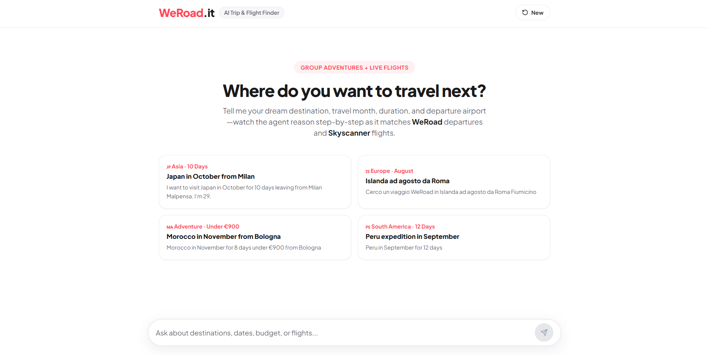
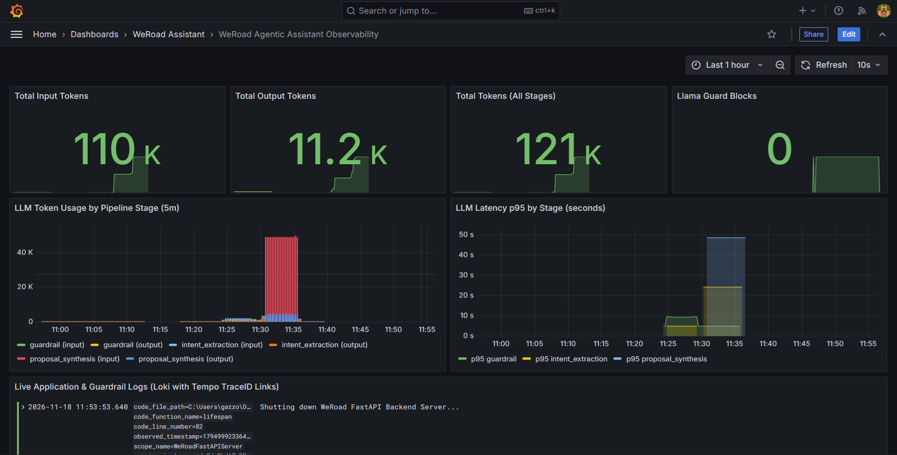

# WeRoad Agentic Travel Assistant

An end-to-end, safety-guarded agentic travel advisor built with **Python**, **Pydantic v2**, **PydanticAI**, **FastAPI**, and the **Model Context Protocol (MCP)**. It helps travelers discover **WeRoad.it** group itineraries, inspects live scheduled departure dates (*turni*), verifies availability statuses and age cohorts, and pairs matching tour dates with **Skyscanner** round-trip flight prices, durations, stops, and direct booking links—all while streaming its intermediate reasoning and live tool actions step by step.

## Overview & Summary

Planning a group adventure involves coordinating tour availability, age cohorts, budget constraints, and round-trip flights from a specific departure airport. The **WeRoad Agentic Travel Assistant** automates this workflow through a transparent, multi-stage AI pipeline:

- **Natural-Language Understanding & Airport Verification**: Extracts structured travel preferences (destination, Italian slug keywords, travel dates, duration, budget, and traveler age) from free-form English or Italian queries, prompting for an origin airport whenever omitted.
- **Live Catalog & Flight Matching via MCP**: Connects an LLM agent to live **WeRoad.it** itinerary/departure scrapers and **Skyscanner** flight search tools over MCP (`stdio`).
- **Transparent Reasoning Stream**: Configured out of the box with **OpenRouter's Free Models Router (`openrouter:openrouter/free`)** and unified reasoning tokens enabled, emitting real-time Server-Sent Events (`POST /api/v1/chat/stream`) to a reactive **React + Tailwind CSS** web interface (`index.html`) so users can watch every safety check, model thought, parsed intent decision, and flight/tour lookup as it happens.
- **Flexible & Production-Ready**: Works out of the box with zero GPU requirements via **OpenRouter** (`openrouter:openrouter/free`), while also supporting 100% local execution via **Ollama** or Hugging Face **`transformers`**, native cloud providers (**OpenAI**, **Anthropic**, **Gemini**, **Groq**, **Mistral**, **DeepSeek**, etc.), input/output **Llama Guard** safety moderation, and full **OpenTelemetry** observability (**Grafana Tempo**, **Loki**, and **Prometheus**).

---

## Key Features

- **Two-Stage Agentic Orchestration (`src/ai_assistant/core/orchestrator.py`)**:
  - **Stage 1 — Intent Extraction**: Parses natural-language travel queries into a structured `TravelSearchIntent` schema (destination, normalized Italian URL slug keywords, departure airport & 3-letter IATA code, destination IATA code, date bounds, trip duration, budget, travel style, and traveler age).
  - **Departure Airport Gate**: Automatically prompts the user for their departure airport if omitted (`needs_departure_airport = True`) so flight searches are always anchored to a real origin hub.
  - **Stage 2 — Tool-Equipped Search & Synthesis**: Uses MCP tools to search the WeRoad catalog, inspect live departure dates, look up matching round-trip flights on Skyscanner, and synthesize a structured `TravelProposalResponse` in the user's language.
- **OpenRouter Free Models Router & Unified Reasoning (`src/ai_assistant/core/agent.py`, `config/config.yaml`)**:
  - Defaults to `openrouter:openrouter/free`, which dynamically routes requests to available free models supporting required capabilities (tool calling, structured outputs, and reasoning tokens).
  - Supports OpenRouter's unified `reasoning` parameters (`reasoning_enabled`, `reasoning_effort`, `reasoning_max_tokens`, and `reasoning_exclude`) per pipeline stage and streams model thinking tokens live as `ThinkingPart` (`reasoning`) events via `run_stream()`.
- **Real-Time Agent Reasoning & Step Streaming (`agent.py`, `orchestrator.py`, `server.py`)**:
  - Streams live `AgentStreamEvent` updates (`status`, `reasoning`, `tool_call`, `tool_result`, `final`, `error`) over Server-Sent Events (`POST /api/v1/chat/stream`).
  - Surfaces intermediate reasoning (model thinking traces, parsed travel criteria, and tool result evaluations) alongside human-readable tool invocations (e.g., *"Looking for round-trip flights for 1 passenger from MXP to TYO..."*).
- **Multi-Backend LLM Support (`src/ai_assistant/core/agent.py`)**:
  - Seamlessly switch between **OpenRouter** (`openrouter:openrouter/free` or specific `:free` / BYOK models), local **Ollama** (`ollama:qwen2.5:1.5b`, `ollama:qwen2.5:3b`), in-process Hugging Face **`transformers`** (with optional `load_in_4bit` quantization), **Hugging Face Inference Providers** (`huggingface:<repo_id>`), and any native **PydanticAI** provider (`openai:`, `anthropic:`, `google-gla:`, `groq:`, `mistral:`, `deepseek:`, etc.).
- **Model Context Protocol (MCP) Tool Server (`src/ai_assistant/mcp_server/weroad_mcp.py`)**:
  - Exposes `search_weroad_tours`, `get_tour_departures`, and `search_flights` over `stdio` using `FastMCP`.
- **Live WeRoad Scraper & Sitemap Indexer (`src/ai_assistant/tools/weroad_parser.py`)**:
  - Discovers active `/viaggi/<slug>` itineraries from WeRoad XML sitemaps with a 6-hour local JSON cache (`.weroad_catalog_cache.json`) and `/destinazioni/<keyword>` fallback discovery.
  - Parses embedded Next.js `__NEXT_DATA__`, JSON-LD blocks, and DOM elements to extract departure dates, EUR pricing, active promotions, age cohorts (`18-24`, `25-35`, `35-49`, `Tutti`), and statuses (`Confermato`, `Quasi pieno`, `Disponibile`, `Sold out`).
- **Skyscanner Round-Trip Flight Integration (`src/ai_assistant/tools/flight_search.py`)**:
  - Resolves cities, countries, and airports to 3-letter IATA codes, builds pre-filled Skyscanner round-trip URLs (`skyscanner.it`), queries live Skyscanner itineraries via RapidAPI when `RAPIDAPI_KEY` is configured, and falls back to route-calibrated EUR cost and duration benchmarks.
- **Input & Output Safety Guardrails (`src/ai_assistant/core/guardrail.py`)**:
  - Moderates every incoming user query and outgoing assistant response across safety categories `S1`–`S13` with configurable fail-closed/fail-open policies (configured with `openrouter:openrouter/free` and `reasoning_enabled: false` for fast binary classification, or compatible with local Ollama / `openrouter:meta-llama/llama-guard-4-12b`).
- **Multiple User Interfaces (`index.html`, `server.py`)**:
  - **Reactive Web Chat UI (`index.html`)**: Single-file React 18 + Tailwind CSS frontend served directly by FastAPI (`/` and `/ui`) featuring a live collapsible **Agent Reasoning & Execution Stream** timeline, interactive WeRoad itinerary cards, departure date tables, Skyscanner deep links, and run telemetry.
  - **FastAPI REST & SSE Backend (`server.py`)**: Exposes `/api/v1/chat/stream` (SSE), `/api/v1/chat` (JSON), `/health`, and `/metrics`.
- **Full OpenTelemetry Observability (`src/ai_assistant/observability/observability.py` & `grafana/`)**:
  - Exports distributed traces to **Grafana Tempo**, correlated structured JSON logs (`trace_id`, `span_id`) to **Grafana Loki**, and token/latency/guardrail metrics to **Prometheus** and **Grafana**.

---

## System Architecture

```text
+-----------------------------------------------------------------------------------+
|                              Client Entrypoints                                   |
|     React + Tailwind UI (index.html)    |   REST/SSE Clients   |
+-----------------------------------------+-----------------------------------------+
                                          |
                                          v (SSE /api/v1/chat/stream or /api/v1/chat)
+-----------------------------------------------------------------------------------+
|                        Step 0: Input Safety Guardrail                             |
|       LlamaGuardModerator.check_input() [OpenRouter Free / Llama Guard]           |
+-----------------------------------------+-----------------------------------------+
                                          | (Safe)
                                          v
+-----------------------------------------------------------------------------------+
|                    Stage 1: Natural-Language Intent Parser                        |
|      GenericAgent (openrouter/free + Reasoning) -> TravelSearchIntent             |
|       [Streams model reasoning & extracted destination / dates / IATA codes]      |
+-----------------------------------------+-----------------------------------------+
                                          |
                     +--------------------+--------------------+
                     | (Departure Airport Missing)             | (Airport Present)
                     v                                         v
+-----------------------------------------+   +-------------------------------------+
|   Prompt User for Departure Airport     |   | Stage 2: Tool-Equipped Advisor      |
|   (needs_departure_airport = True)      |   | GenericAgent.run_stream()           |
+-----------------------------------------+   | [OpenRouter Free + Reasoning]       |
                                              +------------------+------------------+
                                                                 | (MCP stdio)
                                                                 v
                                              +-------------------------------------+
                                              |   WeRoad MCP Server (weroad_mcp.py) |
                                              |  - search_weroad_tours()            |
                                              |  - get_tour_departures()            |
                                              |  - search_flights()                 |
                                              +---------+-----------------+---------+
                                                        |                 |
                                                        v                 v
                                              +-----------------+ +-----------------+
                                              |  WeRoadClient   | |FlightSearchClt. |
                                              |  (weroad.it)    | |(Skyscanner.it)  |
                                              +-----------------+ +-----------------+
                                                                 |
                                                                 v
+-----------------------------------------------------------------------------------+
|                        Step 3: Output Safety Guardrail                            |
|      LlamaGuardModerator.check_output() [OpenRouter Free / Llama Guard]           |
+-----------------------------------------+-----------------------------------------+
                                          | (Safe)
                                          v
+-----------------------------------------------------------------------------------+
|            TravelProposalResponse (Tours, Departures, Flights, Telemetry)         |
+-----------------------------------------------------------------------------------+
```

---

## Demo & Screenshots

Sample captures and an exported interactive snapshot of the assistant in action are available in the [`demo-example/`](demo-example/) folder:

### 1. Interactive Web UI & Live Reasoning Stream

The React + Tailwind CSS interface (`index.html`) streams safety guardrail checks, model reasoning tokens, parsed travel criteria, and MCP tool calls in real time alongside departure airport controls and starter prompts:



### 2. Travel Itinerary & Skyscanner Flight Proposal Output

Once Stage 2 completes, the assistant renders structured WeRoad tour cards, live departure date tables (*turni*), EUR pricing, age cohorts, and matched Skyscanner round-trip flight options:

- **Interactive HTML Snapshot:** [WeRoad.it - AI Trip & Flight Finder.html](demo-example/WeRoad.it%20-%20AI%20Trip%20&%20Flight%20Finder.html) *(open directly in a browser to explore the captured response)*


### 3. Grafana LLM Performance & Observability Dashboard

Every query emits distributed traces, structured logs, and Prometheus metrics visualized in the pre-provisioned Grafana dashboard (`grafana/grafana-dashboard.json`):



---

## Project Structure

```text
Travel-AI-assistant/
├── config/
│   ├── config.yaml                              # Centralized pipeline, OpenRouter reasoning, guardrail, scraper & OTel config
│   └── mcp_config.json                          # MCP stdio server command definition ("weroad")
├── demo-example/
│   ├── grafana.png                              # Grafana observability dashboard screenshot
│   ├── webui.png                                # Web UI & live reasoning stream screenshot
│   ├── WeRoad.it - AI Trip & Flight Finder.html # Exported interactive HTML demo output
│   └── WeRoad.it - AI Trip & Flight Finder.png  # Screenshot of rendered trip & flight proposal output
├── grafana/
│   ├── grafana-dashboard.json                   # Pre-built Grafana dashboard definition
│   ├── grafana-dashboards.yaml                  # Grafana dashboard provisioning config
│   ├── grafana-datasources.yaml                 # Auto-provisioned Prometheus, Tempo & Loki datasources
│   ├── loki.yaml                                # Grafana Loki native OTLP log ingestion config
│   ├── prometheus.yaml                          # Prometheus scrape config for FastAPI /metrics & Tempo
│   └── tempo.yaml                               # Grafana Tempo OTLP receiver & span-metrics generator config
├── src/
│   └── ai_assistant/
│       ├── core/
│       │   ├── agent.py                         # GenericAgent wrapper around PydanticAI Agent, OpenRouter reasoning & run_stream()
│       │   ├── config_management.py             # Singleton ConfigManager loading .env and YAML configs
│       │   ├── guardrail.py                     # LlamaGuardModerator for input/output safety checks (S1–S13)
│       │   └── orchestrator.py                  # Two-stage WeRoadTravelAssistant with stream_query() & I/O guardrails
│       ├── mcp_server/
│       │   └── weroad_mcp.py                    # FastMCP stdio server exposing tour & flight search tools
│       ├── observability/
│       │   └── observability.py                 # OpenTelemetry Tempo traces, Loki OTLP logs & Prometheus metrics
│       ├── schemas/
│       │   └── schemas.py                       # Pydantic v2 models for configs, reasoning settings, intents, tours & SSE events
│       └── tools/
│           ├── flight_search.py                 # IATA resolver, Skyscanner deep-link builder & RapidAPI client
│           └── weroad_parser.py                 # Async WeRoad.it XML sitemap indexer & HTML/JSON departure parser
├── .env                                         # Local environment variables (OPENROUTER_API_KEY, RAPIDAPI_KEY, etc.)
├── .gitattributes                               # Git line-ending & diff attributes
├── .gitignore                                   # Git ignore rules
├── docker-compose.yaml                          # Docker Compose stack for Tempo, Loki, Prometheus & Grafana
├── index.html                                   # Reactive React 18 + Tailwind CSS frontend with live SSE step stream
├── pyproject.toml                               # Project metadata & dependencies (uv / pip)
├── README.md                                    # Project documentation
├── server.py                                    # FastAPI backend (/ui, /api/v1/chat/stream, /api/v1/chat, /health, /metrics)
└── uv.lock                                      # Locked dependency graph
```

---

## Supported Model Providers & LLMs

`GenericAgent` (`src/ai_assistant/core/agent.py`) supports **four explicitly integrated model backends** plus **any native PydanticAI provider** via pass-through model identifiers. You can configure a single default model or assign different providers to individual pipeline stages (`llm_default`, `llm_intent`, `llm_proposal`, and `llama_guard`) in `config/config.yaml`.

### 1. Explicitly Integrated Backends

| Backend | `model_name` Format | Example Models | Required / Optional Env Vars | Supported Config Options |
| :--- | :--- | :--- | :--- | :--- |
| **OpenRouter** *(Default)* | `openrouter:<model_id>` | `openrouter:openrouter/free` (Free Models Router), `openrouter:nvidia/nemotron-3-nano-30b-a3b:free`, `openrouter:meta-llama/llama-guard-4-12b` | **Required:** `OPENROUTER_API_KEY`<br>*Optional:* `OPENROUTER_SITE_URL`, `OPENROUTER_APP_NAME` | `reasoning_enabled`, `reasoning_effort`, `reasoning_max_tokens`, `reasoning_exclude`, `base_url` |
| **Local Ollama** | `ollama:<model_tag>` | `ollama:qwen2.5:1.5b`, `ollama:qwen2.5:3b`, `ollama:llama3.2:3b` | *Optional:* `OLLAMA_BASE_URL` (default `http://localhost:11434/v1`), `OLLAMA_NUM_CTX` (default `3072`) | `base_url`, `temperature`, `max_tokens` |
| **Local Hugging Face `transformers`** | `transformers:<repo_id>` | `transformers:google/gemma-3-1b-it`, `transformers:Qwen/Qwen2.5-1.5B-Instruct` | *Optional:* `HF_TOKEN` (for gated repositories) | `device` (`"auto"`, `"cuda"`, `"mps"`, `"cpu"`), `torch_dtype` (`"auto"`, `"float16"`, `"bfloat16"`), `load_in_4bit` (`true`/`false`) |
| **Hugging Face Inference Providers** | `huggingface:<repo_id>` | `huggingface:google/gemma-3-27b-it` | **Required:** `HF_TOKEN` | `provider` (e.g., `"hf-inference"`, `"together"`, `"fireworks-ai"`) |

### 2. Native PydanticAI Pass-Through Providers

Any `model_name` that does not use one of the four prefixes above is passed directly to `pydantic_ai.Agent(...)`. With the corresponding PydanticAI provider extra/SDK installed, any standard `<provider>:<model>` identifier works out of the box:

| Provider | Example `model_name` | Required Environment Variable |
| :--- | :--- | :--- |
| **OpenAI** | `openai:gpt-4o-mini`, `openai:gpt-4.1` | `OPENAI_API_KEY` |
| **Anthropic** | `anthropic:claude-sonnet-4-5` | `ANTHROPIC_API_KEY` |
| **Google Gemini (GLA)** | `google-gla:gemini-2.5-flash` | `GEMINI_API_KEY` |
| **Google Vertex AI** | `google-vertex:gemini-2.5-flash` | Google Cloud ADC credentials |
| **Groq** | `groq:llama-3.3-70b-versatile` | `GROQ_API_KEY` |
| **Mistral** | `mistral:mistral-large-latest` | `MISTRAL_API_KEY` |
| **DeepSeek** | `deepseek:deepseek-chat` | `DEEPSEEK_API_KEY` |
| **Cohere** | `cohere:command-r-plus` | `COHERE_API_KEY` |
| **AWS Bedrock** | `bedrock:anthropic.claude-3-5-sonnet-20241022-v2:0` | AWS credentials (`AWS_ACCESS_KEY_ID`, etc.) |

### 3. Using Your Own OpenAI Key Alongside OpenRouter

You can use your own OpenAI API key (`sk-...`) while keeping OpenRouter in two ways:

- **Option A — OpenRouter BYOK (Bring Your Own Key)**:
  1. Add your OpenAI key (`sk-...`) under **OpenRouter → Settings → Integrations → OpenAI** (`https://openrouter.ai/settings/integrations`).
  2. Keep `OPENROUTER_API_KEY` in `.env` and use an OpenAI model slug with the `openrouter:` prefix in `config/config.yaml` (e.g., `model_name: "openrouter:openai/gpt-4o-mini"`). OpenRouter will automatically route `openai/*` calls through your own OpenAI key while preserving unified OpenRouter routing and analytics.
- **Option B — Hybrid Per-Stage Routing**:
  Add both `OPENROUTER_API_KEY` and `OPENAI_API_KEY` to `.env`, and assign `openai:<model>` to specific stages in `config/config.yaml` while keeping `openrouter:openrouter/free` on others:
  ```yaml
  pipeline:
    llm_intent:
      model_name: "openai:gpt-4o-mini"          # Uses OPENAI_API_KEY directly
    llm_proposal:
      model_name: "openrouter:openrouter/free"   # Uses OPENROUTER_API_KEY with reasoning
      reasoning_enabled: true
      reasoning_effort: "medium"
  ```

### 4. Telemetry & Metrics Compatibility Across Providers

All observability metrics (`weroad_llm_tokens`, `weroad_llm_requests`, `weroad_llm_request_duration_seconds`, Tempo traces, Loki logs, and the Web UI telemetry drawer) are recorded inside `GenericAgent` and tagged with `stage` and `model`:
- **Latency, request counts, and distributed traces** work identically across **every** provider.
- **Token counts (`input_tokens`, `output_tokens`, `total_tokens`)** are captured across all providers (computed directly from tokenizer tensors for local `transformers`, populated natively by PydanticAI for OpenAI/Anthropic/Gemini/Groq/Mistral/DeepSeek, and requested via `include_usage` for OpenRouter—note that occasional upstream `:free` models behind `openrouter/free` may omit `usage` on streamed tool turns, whereas BYOK/paid models always report exact counts).

---

## Prerequisites & Installation

### 1. Clone the Repository

```bash
git clone <repository-url>
cd Travel-AI-assistant
```

### 2. Obtain an OpenRouter API Key (Default Setup)

The default configuration (`config/config.yaml`) uses **OpenRouter's Free Models Router** (`openrouter:openrouter/free`) with reasoning enabled—requiring **no local GPU** and **zero per-token cost**:

1. Create a free account at [openrouter.ai](https://openrouter.ai) and generate an API key at [openrouter.ai/keys](https://openrouter.ai/keys).
2. Add `OPENROUTER_API_KEY` to your `.env` file (see [Configuration](#configuration) below).

*(Optional — Local Offline Setup via Ollama)*: If you prefer running models 100% locally without internet access for LLM calls, install [Ollama](https://ollama.com), run `ollama pull qwen2.5:1.5b` (or `qwen2.5:3b`), and switch `model_name` in `config/config.yaml` to `"ollama:qwen2.5:1.5b"`.

### 3. Install Python Dependencies

#### Option A: Using `uv` (Recommended)

```bash
uv sync
```

#### Option B: Using `pip` and a Virtual Environment

```bash
python -m venv .venv
source .venv/bin/activate        # On Windows: .venv\Scripts\activate

pip install "pydantic>=2.9.0" "pydantic-ai[openai]>=0.1.0" "mcp>=1.2.0" "httpx>=0.27.2" \
  "beautifulsoup4>=4.12.3" pyyaml python-dotenv fastapi uvicorn \
  opentelemetry-api opentelemetry-sdk opentelemetry-exporter-otlp-proto-http \
  opentelemetry-exporter-prometheus prometheus-client
```

---

## Configuration

### 1. Environment Variables (`.env`)

Create or update `.env` in the project root directory:

```env
# Required for default OpenRouter Free Models Router (`openrouter:openrouter/free`)
OPENROUTER_API_KEY=your_openrouter_api_key_here

# Optional OpenRouter app attribution headers
OPENROUTER_SITE_URL=http://localhost:8000
OPENROUTER_APP_NAME=WeRoad Travel Assistant

# Optional: Enables live Skyscanner quotes via RapidAPI (Sky-Scrapper API).
# If omitted, the assistant automatically uses route-calibrated EUR price/duration
# estimates alongside exact pre-filled Skyscanner search links.
RAPIDAPI_KEY=your_rapidapi_key_here

# Optional: Required only if switching stages in config/config.yaml to other providers
OPENAI_API_KEY=your_openai_api_key_here
ANTHROPIC_API_KEY=your_anthropic_api_key_here
GEMINI_API_KEY=your_gemini_api_key_here
OLLAMA_BASE_URL=http://localhost:11434/v1
HF_TOKEN=your_huggingface_token_here
```

### 2. Application Configuration (`config/config.yaml`)

`ConfigManager` loads `config/config.yaml` at startup and validates it into `WeRoadAssistantConfig`:

- **`pipeline`**:
  - `llm_default`, `llm_intent`, `llm_proposal`: Configure `model_name` (default `"openrouter:openrouter/free"`), `temperature`, `max_tokens`, and OpenRouter unified reasoning settings per stage:
    - `reasoning_enabled` (`true` / `false`): Enables or disables reasoning tokens.
    - `reasoning_effort` (`"none"`, `"minimal"`, `"low"`, `"medium"`, `"high"`, `"xhigh"`, `"max"`): Controls the reasoning depth (`"low"` for fast intent parsing, `"medium"` for multi-step tour & flight synthesis).
    - `reasoning_max_tokens` (optional `int`): Explicit reasoning token budget (mutually exclusive with `reasoning_effort`).
    - `reasoning_exclude` (optional `bool`): When `true`, reasons internally without returning reasoning text in the stream.
  - Also supports `"ollama:<model>"`, `"transformers:<repo_id>"` (with `device`, `torch_dtype`, and `load_in_4bit`), `"huggingface:<repo_id>"`, and native PydanticAI identifiers (`"openai:..."`, `"anthropic:..."`, `"google-gla:..."`, etc.).
  - `intent_request_limit` (`2`) and `proposal_request_limit` (`10`): Cap LLM/tool round-trips.
  - `require_departure_airport` (`true`): Prompts the user for their origin airport when omitted.
- **`llama_guard`**:
  - `enabled`, `check_input`, `check_output`: Toggle input and output safety moderation.
  - `model_name`: Defaults to `"openrouter:openrouter/free"` with `reasoning_enabled: false` so binary `safe`/`unsafe` checks return quickly within `max_tokens: 100` (can also be set to `"openrouter:meta-llama/llama-guard-4-12b"` or `"ollama:qwen2.5:1.5b"`).
  - `fail_open`: Defaults to `false` (blocks requests if the moderation service fails).
  - `category_map`: Maps safety codes `S1`–`S13` to human-readable descriptions.
- **`scraper`**:
  - `base_url`, `sitemap_url`, `cache_path` (`.weroad_catalog_cache.json`), `cache_ttl_seconds` (`21600`), `timeout_seconds`, and `max_concurrent_requests`.
- **`flight_search`**:
  - `enabled`, `provider` (`"skyscanner"`), `currency` (`"EUR"`), `market` (`"IT"`), `locale` (`"it-IT"`), `skyscanner_base_url` (`https://www.skyscanner.it/trasporti/voli`), and `rapidapi_host`.
- **`server`**:
  - `host` (`"0.0.0.0"`), `port` (`"8000"`), `api_base_url`, and `cors_origins`.
- **`observability`**:
  - `enabled`, `service_name`, OTLP endpoints for Tempo (`4318`) and Loki (`3100`), `grafana_base_url`, `capture_prompts`, and `json_logs`.
- **`schemas`**:
  - `mcp_config_path`: Defaults to `"config/mcp_config.json"`.

---

## How to Run

### 1. Web Interface & FastAPI Backend Server (`server.py` + `index.html`)

Start the FastAPI server on port `8000`:

```bash
uvicorn server:app --host 0.0.0.0 --port 8000 --reload
```

Open **`http://localhost:8000`** (or **`http://localhost:8000/ui`**) in your browser to launch the React + Tailwind CSS web application, where you can:
- Watch the live collapsible **Agent Reasoning & Execution Stream** as the assistant checks safety policies, streams model reasoning tokens, parses your travel intent, searches WeRoad tours, verifies departure dates (*turni*), and looks up Skyscanner flights
- Pre-select a default departure airport (`MXP`, `LIN`, `BGY`, `FCO`, `VCE`, `BLQ`, `NAP`, etc.) or type a custom airport/IATA code from the top navigation bar
- Launch starter prompts or chat naturally in English or Italian
- Browse interactive WeRoad tour cards, live departure date tables, Skyscanner round-trip flight links, and per-run token telemetry

Available HTTP endpoints:
- `GET /` — Serves the React + Tailwind CSS web UI (`index.html`) in browsers, or service metadata JSON for API clients
- `GET /ui` — Serves the React + Tailwind CSS web UI (`index.html`)
- `POST /api/v1/chat/stream` — Streams real-time `AgentStreamEvent` Server-Sent Events (`text/event-stream`)
- `POST /api/v1/chat` — Standard synchronous JSON endpoint returning `TravelProposalResponse`
- `GET /health` — Health check, active model, and guardrail status
- `GET /metrics` — Prometheus metrics exposition (`weroad_llm_tokens`, `weroad_llm_requests`, `weroad_llm_request_duration_seconds`, `weroad_guardrail_checks`)
- `GET /docs` — Interactive Swagger UI documentation

Example SSE streaming request:

```bash
curl -N -X POST http://localhost:8000/api/v1/chat/stream \
  -H "Content-Type: application/json" \
  -d '{
    "query": "I want to visit Japan in October for 10 days. I am 29.",
    "departure_airport": "MXP",
    "session_id": "demo-session-1"
  }'
```

Example synchronous JSON request:

```bash
curl -X POST http://localhost:8000/api/v1/chat \
  -H "Content-Type: application/json" \
  -d '{
    "query": "I want to visit Japan in October for 10 days. I am 29.",
    "departure_airport": "MXP",
    "session_id": "demo-session-1"
  }'
```

### 2. Running the MCP Server Standalone

To inspect or test the MCP tool server directly (e.g., with MCP Inspector):

```bash
PYTHONPATH=src python -m ai_assistant.mcp_server.weroad_mcp
```

*Note: `weroad_mcp.py` routes all application logs strictly to `stderr` so the `stdout` JSON-RPC stream remains clean for MCP clients.*

---

## Observability Stack (Grafana, Tempo, Loki & Prometheus)

1. **Start the observability stack** using `docker-compose.yaml` and the provisioning configs in `grafana/`:
   ```bash
   docker-compose up -d
   ```
2. **Access the dashboards**:
   - **Grafana**: `http://localhost:3000` (auto-provisioned with `grafana/grafana-datasources.yaml`, `grafana/grafana-dashboards.yaml`, and `grafana/grafana-dashboard.json` — see preview in [`demo-example/grafana.png`](demo-example/grafana.png))
   - **Prometheus**: `http://localhost:9090` (configured via `grafana/prometheus.yaml`)
   - **Tempo**: `http://localhost:3200` / OTLP HTTP `4318` (configured via `grafana/tempo.yaml`)
   - **Loki**: `http://localhost:3100` (configured via `grafana/loki.yaml`)
3. **Trace & Log Correlation**:
   - Every request generates a root trace span (`HTTP POST /api/v1/chat/stream` or `HTTP POST /api/v1/chat` -> `weroad.handle_query` -> `agent.intent_extraction` -> `agent.proposal_synthesis.stream`) and returns an `X-Trace-Id` response header.
   - Python logs automatically inject `trace_id` and `span_id`, enabling one-click navigation between **Grafana Loki** logs and **Grafana Tempo** waterfall traces, as well as direct trace links inside the web UI's collapsible run metrics panel.

---

## Troubleshooting

- **Missing or Invalid `OPENROUTER_API_KEY`**: Ensure `OPENROUTER_API_KEY` is set in `.env` in the project root when using `openrouter:openrouter/free` or any `openrouter:...` model.
- **OpenRouter Free Tier Rate Limits or Empty Output**: Free models behind `openrouter/free` share public rate limits and allocate part of `max_tokens` to reasoning tokens. If a response truncates during heavy reasoning, increase `max_tokens` (e.g., `4096` or `8192`) or lower `reasoning_effort` from `"medium"` to `"low"` in `config/config.yaml`.
- **Local Ollama Connection Refused (if using `ollama:...`)**: Ensure the Ollama service is running (`ollama serve`) on `http://localhost:11434` and that you have pulled the configured model (`ollama pull qwen2.5:1.5b`).
- **Web UI Not Loading (`404` on `/ui`)**: Ensure `index.html` is located in the project root directory alongside `server.py`.
- **MCP Config Not Found**: Ensure `schemas.mcp_config_path` in `config/config.yaml` points to `"config/mcp_config.json"`.